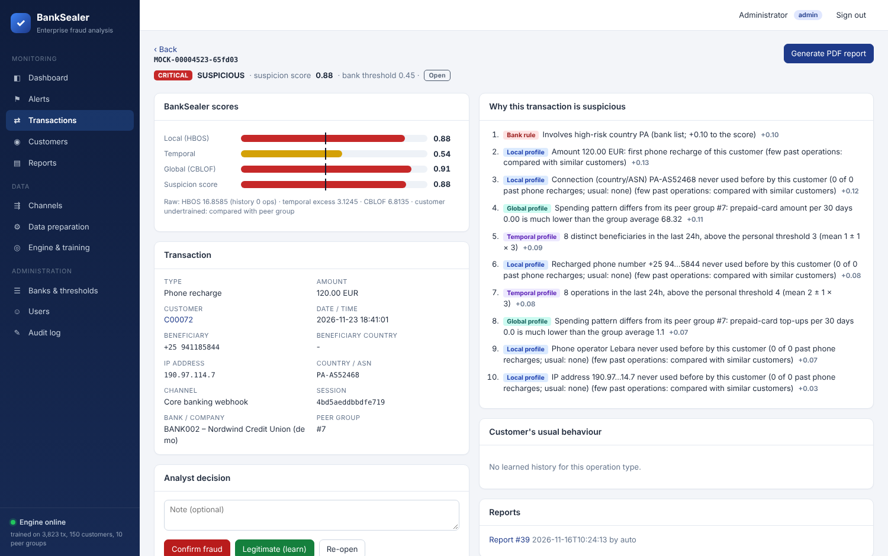
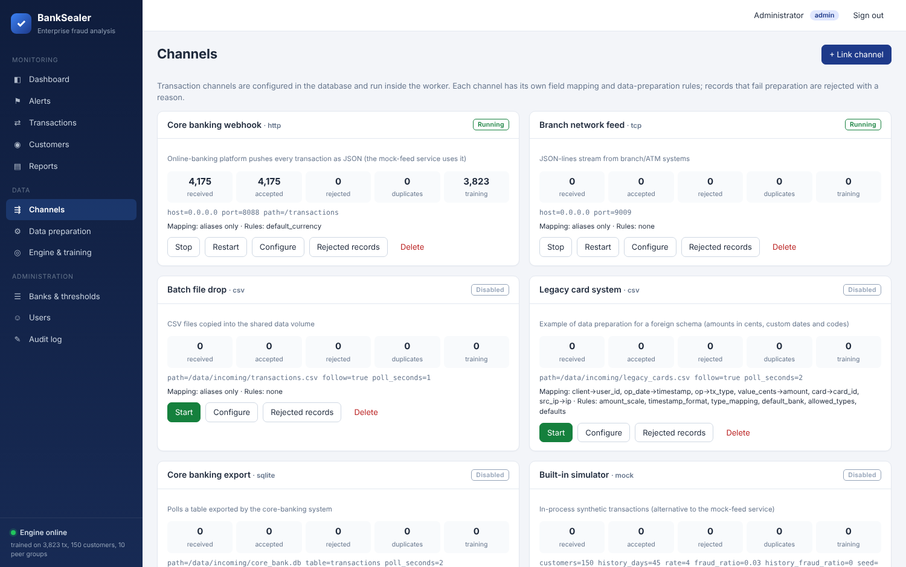
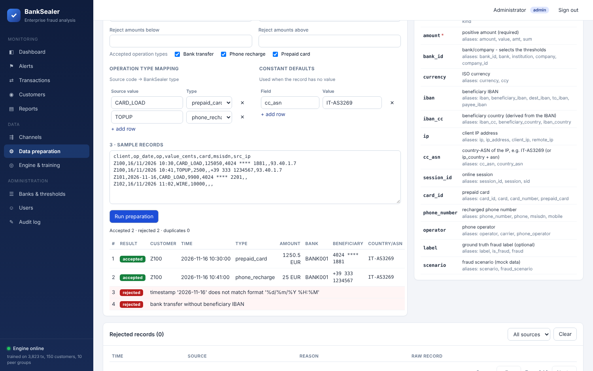
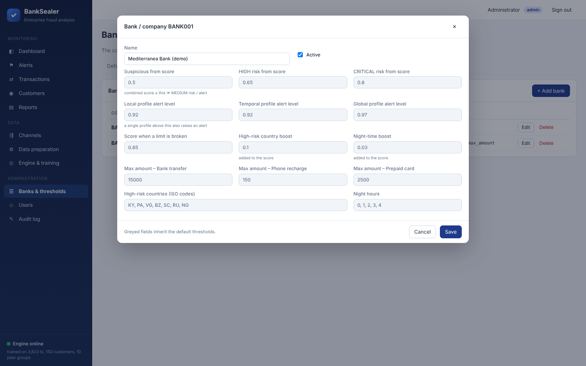
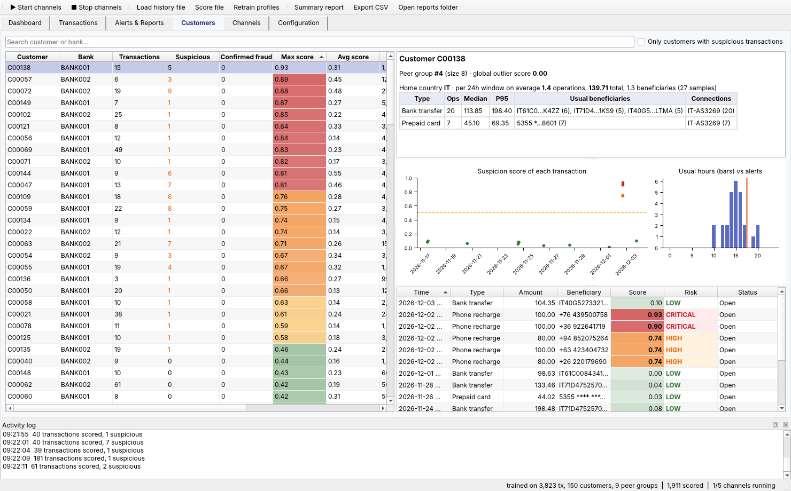
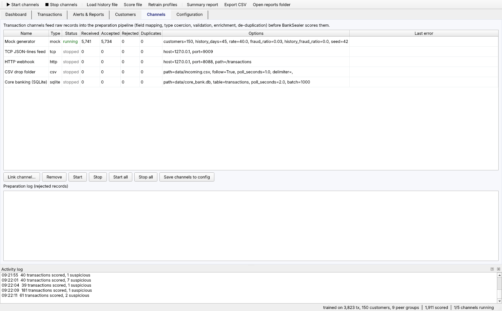

# BankSealer Fraud Detection: Enterprise Solution

An enterprise platform for online-banking fraud analysis based on the **BankSealer** framework
(Carminati et al., *"BankSealer: A decision support system for online banking fraud analysis and
investigation"*, Computers & Security 2015). It runs with **Docker Compose** and has:

* **Frontend**: a React web console (nginx) with the dashboard, alerts with explanations,
  customers, reports, channels, data preparation, engine, banks & thresholds, users and audit log.
* **Backend**:
  * a **REST API** (FastAPI, JWT authentication, viewer/analyst/admin roles, audit log, OpenAPI docs)
  * a **worker** that runs the transaction channels, data preparation and the BankSealer engine:
    local HBOS, temporal thresholds, global DBSCAN + CBLOF
* **Configuration database** (PostgreSQL): banks/companies and their thresholds, engine
  parameters, **channel configurations** (connector, field mapping, preparation rules) and users.
  Changes made in the console apply to the running worker within seconds.
* **Mock data channel**: a Python generator that streams 45 days of history and then live
  transactions with injected fraud into the HTTP webhook channel.


## Run it

```bash
cp .env.example .env          # change ADMIN_PASSWORD, JWT_SECRET, POSTGRES_PASSWORD
```
```bash
docker compose --profile demo up -d --build
```

| URL | What |
|-----|------|
| http://localhost:8080 | Web console. Sign in with `admin` / the `ADMIN_PASSWORD` from `.env` (default `admin123`) |
| http://localhost:8000/api/docs | REST API (Swagger / OpenAPI) |
| `localhost:8088/transactions` | HTTP webhook channel (`POST` JSON) |
| `localhost:9009` | TCP JSON-lines channel |

Without `--profile demo` the stack starts without the mock feed, ready for your own channels.
`docker compose logs -f worker` shows the channels, training and scoring.

```
browser ─► frontend (nginx + React) ─/api─► api (FastAPI) ─┐
core banking ─► :8088 webhook ─┐                            ├─► PostgreSQL (configuration + data)
branch feeds ─► :9009 TCP ─────┼─► worker (channels → preparation → BankSealer) ─┘
files (/data/incoming) ────────┘           └─► PDF reports (/data/reports)
mock-feed (demo profile) ─► :8088
```

### What you can do in the console

| Page | |
|------|---|
| **Dashboard** | KPIs (scored, suspicious, critical, open alerts, amount at risk), score distribution against the thresholds, suspicious per day, by bank and type, profile scores, top detection reasons, channel status. Can be filtered by bank |
| **Alerts / Transactions** | Filter and sort by bank, type, risk, status and search. CSV export, summary PDF report |
| **Transaction detail** | Local / temporal / global / combined score bars against the bank threshold, **why it is suspicious** (ranked findings with their impact), the customer's usual behaviour, a PDF report, and the analyst decision (*confirm fraud*, *legitimate*, which the profile then learns) |
| **Customers** | Per-customer statistics, peer group, global outlier score, learned profile, score timeline, hours of activity |
| **Reports** | Automatic and on-demand PDF reports, summaries |
| **Channels** | Link, configure, start, stop and restart channels (HTTP, TCP, CSV, SQLite, mock). Each has connector options, a **field mapping** and **preparation rules**, plus live counters and rejected records |
| **Data preparation** | Workbench: load a channel's mapping and rules, paste sample records and see what is accepted or rejected; save back to the channel |
| **Engine & training** | Worker state, retrain, upload history or files to score, command history |
| **Banks & thresholds** | Default thresholds, per-bank overrides (inherited values greyed), engine/profile parameters, auto-report, YAML import/export |
| **Users / Audit log** | Role-based users, and every change with before and after values |

| Alert detail | Channels |
|---|---|
|  |  |
| **Data preparation** | **Bank thresholds** |
|  |  |

The architecture, the database tables, the channel/preparation reference, the training
lifecycle, security and operations are documented in **[docs/ENTERPRISE.md](docs/ENTERPRISE.md)**.
The algorithm is documented in **[docs/ALGORITHM.md](docs/ALGORITHM.md)**.

### Verifying a deployment

```bash
python scripts/smoke_test.py --url http://localhost:8080 --password admin123
```

It runs 16 end-to-end checks against a running stack. They cover:

* health, login and engine state
* alerts, explanations and PDF reports
* feedback and per-bank re-evaluation
* preparation preview and channel create/delete
* file upload, CSV export, summary report and audit log

### Development without Docker

```bash
pip install -r requirements.txt -r requirements-server.txt httpx
```
```bash
DATABASE_URL=sqlite:///data/dev.db python -m uvicorn server.api.main:app --port 8000
```
```bash
DATABASE_URL=sqlite:///data/dev.db python -m server.worker.main
```
```bash
cd frontend && npm install && npm run dev      # http://localhost:5173 (proxies /api to :8000)
```

Tests: `QT_QPA_PLATFORM=offscreen python -m pytest -q`. This includes the in-process
API + worker integration test, `tests/test_enterprise.py`.

---

The **desktop edition** (PySide6) from the earlier version is still included and uses the same
engine, channels and mock generator:

## Desktop edition: quick start

```bash
pip install -r requirements.txt
python run_desktop.py
```

On startup the *Mock generator* channel creates 45 days of history for 150 customers, the three
profiles are trained on it, and live transactions stream in and are scored. The Linux packages
`libegl1 libgl1 libxkbcommon0 libfontconfig1` may be needed for Qt.

Other launch options:

```bash
python run_desktop.py --no-autostart      # link/start channels yourself from the Channels tab
python run_desktop.py --resume            # continue the previous session (scores + trained model)
python run_desktop.py --config my.yaml    # another configuration
```

## Desktop edition: tabs

| Tab | What it shows |
|-----|---------------|
| **Dashboard** | KPIs (scored, customers, suspicious, rate, critical, open alerts), score distribution with the thresholds, suspicious per day by risk level, suspicious by bank and operation type, average profile scores, latest alerts |
| **Transactions** | Every scored transaction with local / temporal / global / combined score and risk level. Filters: bank, type, risk, status, free-text search. The detail panel shows the score bars and *why* the transaction is suspicious. Actions: PDF report, confirm fraud, mark legitimate (the profile learns it) |
| **Alerts & Reports** | The queue of suspicious transactions, ranked by score. PDF reports for one or all open alerts, a summary PDF report, CSV export |
| **Customers** | Every customer with transactions, suspicious count, max/avg score, peer group and global outlier score. The detail panel shows the learned profile (usual beneficiaries, connections, amounts, hours), the score timeline and the customer's transactions |
| **Channels** | Linked channels with status and preparation statistics (received / accepted / rejected / duplicates) and the preparation log. Link new channels with options and field mapping; start, stop, remove; save to config |
| **Configuration** | Thresholds for the default and for each bank/company: suspicious / high / critical, per-profile alert levels, max amount per operation type, high-risk countries, night hours. Also engine weights and parameters, auto-report, and the full YAML. *Apply* re-evaluates every transaction with the new thresholds immediately |

| Transactions | Customers |
|---|---|
|  |  |
| **Channels** | **Configuration** |
|  |  |

A sample report is in [`docs/samples/sample_transaction_report.pdf`](docs/samples/sample_transaction_report.pdf).
Reports are written to `reports/`. With `app.auto_report: true` a report is created automatically
for every suspicious transaction.

## Linking transaction channels

| Type | How data arrives | Main options |
|------|------------------|--------------|
| `mock` | In-process generator (accelerated simulated clock) | `customers`, `history_days`, `rate`, `fraud_ratio`, `seed` |
| `tcp` | TCP listener, one JSON transaction (or JSON list) per line | `host`, `port` |
| `http` | HTTP webhook, `POST` JSON object / list / `{"transactions": [...]}` | `host`, `port`, `path` |
| `csv` | CSV or `.jsonl` file, optionally followed like `tail -f` | `path`, `follow`, `poll_seconds` |
| `sqlite` | Polls a table for new rows (e.g. a core-banking export) | `path`, `table`, `poll_seconds` |

Each channel can declare a `field_mapping` (`source_field: banksealer_field`). Common aliases
such as `customer_id`, `beneficiary_iban`, `ip_address` and `type: wire` are recognised
automatically. BankSealer fields:

* `user_id`, `timestamp`, `tx_type` (`bank_transfer` | `phone_recharge` | `prepaid_card`), `amount`
* `iban`, `ip`, `cc_asn` (or `ip_country` + `asn`), `bank_id`, `session_id`
* `phone_number`, `operator`, `card_id`

Records that cannot be prepared are rejected and listed with the reason.

## Mock data channel

`mock_channel/generate_transactions.py` simulates customers of two banks with stable habits.
It injects five fraud scenarios:

* information stealing
* transaction hijacking (man-in-the-browser)
* salami burst
* recharge fraud
* prepaid-card drain

It can write to any channel:

```bash
# 60 days of history as CSV (load it with "Load history file…")
python mock_channel/generate_transactions.py --days 60 --output csv --file data/history.csv

# live stream into the app's TCP channel (enable "TCP JSON-lines feed" first)
python mock_channel/generate_transactions.py --days 0 --output tcp --port 9009 --live --rate 5

# HTTP webhook, sent in batches of 20
python mock_channel/generate_transactions.py --days 30 --output http --url http://127.0.0.1:8088/transactions --live --batch 20

# keep appending to an SQLite "core banking" table
python mock_channel/generate_transactions.py --days 30 --output sqlite --file data/core_bank.db --live
```

The generated records include ground-truth columns `is_fraud` and `scenario`. The engine ignores
them; they are only used to measure detection quality.

## The BankSealer engine

See **[docs/ALGORITHM.md](docs/ALGORITHM.md)** for the formulas. In short:

```
local    s_L = 1 − exp(−Σ_i w_i·log(1/hist_i(t_i)) / scale)          per customer & operation type (HBOS)
temporal s_T = 1 − exp(−Σ_f w_f·excess_f / scale)                     sliding 24h window vs mean + k·std
global   s_G = 1 − exp(−(CBLOF − median) / spread)                    iterative DBSCAN (Mahalanobis) + CBLOF
score    S   = w_L·s_L + w_T·s_T + w_G·s_G  (+ bank rules)  → LOW / MEDIUM / HIGH / CRITICAL per bank thresholds
```

Headless use:

```bash
python -m banksealer.cli evaluate --show 3                 # detection quality on mock data
python -m banksealer.cli score --history data/history.csv --input data/new.csv --out reports --reports
```

## Configuration (`config/banksealer.yaml`)

```yaml
thresholds:            # defaults for every bank/company
  suspicious: 0.50
  high: 0.65
  critical: 0.80
  max_amount: {bank_transfer: 15000, phone_recharge: 150, prepaid_card: 2500}
  high_risk_countries: [KY, PA, VG, BZ, SC, RU, NG]
banks:                 # per bank/company overrides (only the keys you set)
  BANK002:
    name: Nordwind Credit Union (demo)
    thresholds: {suspicious: 0.45, max_amount: {bank_transfer: 8000}}
```

The file also contains:

* the profile weights and hyper-parameters (`engine`, `local`, `temporal`, `global`)
* auto-report settings (`app`)
* the channel list (`channels`)

## Project layout

```
banksealer/
  config.py            configuration + per-bank threshold merge
  preparation.py       channel record -> validated Transaction
  channels/            mock, tcp, http, csv, sqlite channels + ChannelManager
  engine/              hbos.py, local_profile.py, temporal_profile.py, global_profile.py, banksealer.py
  controller.py        channels -> engine -> storage/reports (Qt-free)
  storage.py           SQLite persistence (transactions, scores, analyst status, reports)
  reports.py           PDF transaction / summary reports, CSV export
  gui/                 PySide6 desktop UI
  cli.py               headless scoring and evaluation
mock_channel/          transaction generator + CLI
config/banksealer.yaml
tests/                 pytest suite (preparation, profiles, channels, reports, controller, GUI)
run_desktop.py
```

Tests: `QT_QPA_PLATFORM=offscreen python -m pytest -q`

### Project layout (enterprise additions)

```
server/               backend: settings, db, models, config_store, security, mapping
  api/                FastAPI app and routers (auth, users/audit, dashboard, transactions/reports,
                      customers, channels, preparation, config/banks, engine)
  worker/             processing worker (channels -> preparation -> engine -> database)
frontend/             React + TypeScript console (Vite), nginx.conf, Dockerfile
config/enterprise.yaml seed configuration for the configuration database
Dockerfile            backend image (api, worker, mock-feed)
docker-compose.yml    db, api, worker, frontend, mock-feed (demo profile)
scripts/smoke_test.py end-to-end checks against a running stack
```

### Other folders

The `backend/` (Spring Boot), `database/`, `infrastructure/` and `ml/` folders are empty
placeholders from the original plan. The enterprise solution is the `server/` + `frontend/` +
`docker-compose.yml` stack above.
