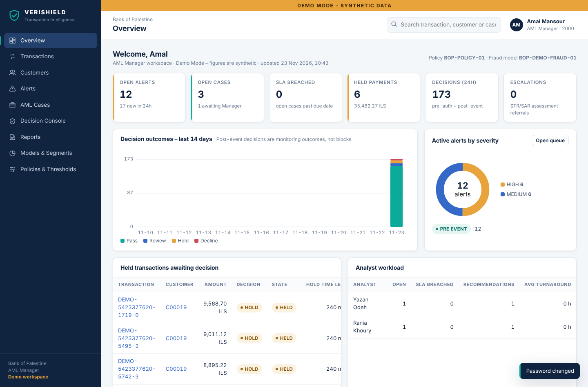
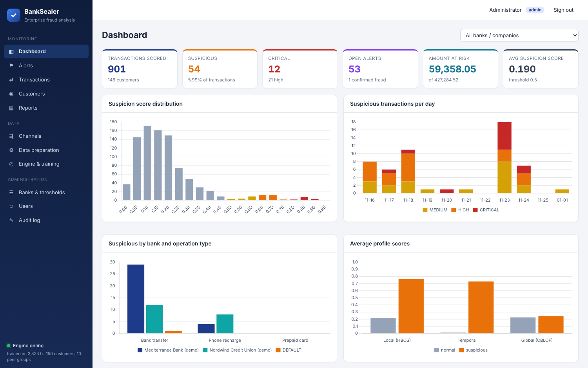
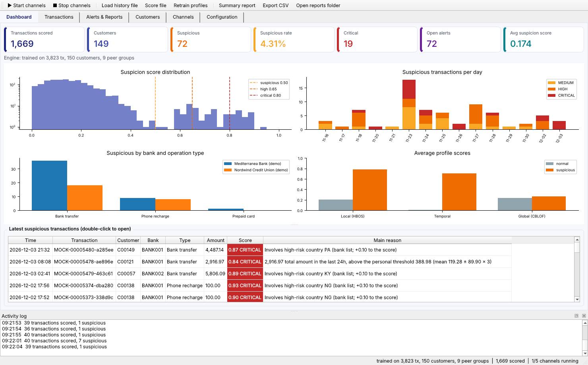
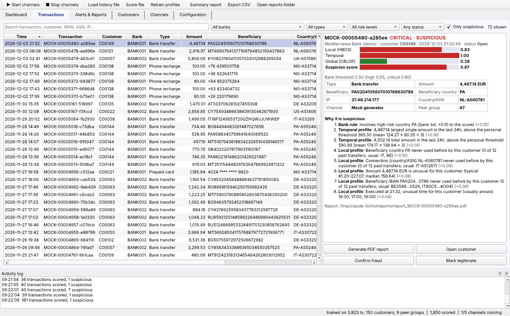
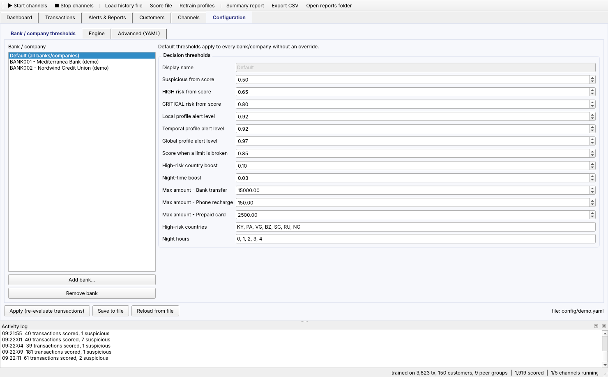

# BankSealer Fraud Detection – VeriShield

This repository contains three products built on the **BankSealer** behavioural fraud-detection engine
(Carminati et al., *Computers & Security* 2015):

| Product | What it is | Start here |
|---|---|---|
| **VeriShield** (main product, v1.4) | Browser-based real-time fraud decisioning, AML case management, regulatory reporting (STR / CTR), customer risk assessment, screening, network and cheque fraud detection, core-banking API registry, high availability, SIEM and AI-agent (MCP) integration | [`docs/verishield/README.md`](docs/verishield/README.md) |
| **BankSealer Enterprise** | Docker stack: React console, REST API, worker and PostgreSQL configuration database | [`docs/ENTERPRISE.md`](docs/ENTERPRISE.md) |
| **BankSealer desktop** | Desktop application and the reference implementation of the engine | below |
| **TrustGraph Knowledge Assistant** | Ask questions over the VeriShield documents in a TrustGraph knowledge graph (Graph RAG, Document RAG, agent) | [`trustgraph_app/README.md`](trustgraph_app/README.md) |

## VeriShield

```bash
./start.sh                      # macOS/Linux (Windows: start.bat) – or:
pip install -r requirements-verishield.txt && python run_verishield.py
```

Open **http://localhost:8000**, sign in with `1000` / `Admin` (IT Admin – you will be asked to change the
password). Development accounts for the other roles are listed on the sign-in page:
`2000` AML Manager, `3001`/`3002` AML Employees, `4000` Chief AML/Compliance, `5000` CEO.
Docker: `docker compose up --build` (or `docker compose -f docker-compose.postgres.yml up --build`).
Windows Server without internet: see [`deploy/windows/README.md`](deploy/windows/README.md) (offline bundle + one-click installer).
High availability, monitoring and security tooling: [`deploy/ha`](deploy/ha/README.md), [`deploy/monitoring`](deploy/monitoring),
[`deploy/security`](deploy/security/scan.py). Solution book (PDF): [`docs/verishield`](docs/verishield).



## BankSealer Enterprise (Docker stack)

```bash
cp .env.example .env          # uncomment and change the Enterprise section (ADMIN_PASSWORD, JWT_SECRET, POSTGRES_PASSWORD)
docker compose -f docker-compose.enterprise.yml --profile demo up -d --build
```

Console http://localhost:8080 (`admin` / `ADMIN_PASSWORD`), API docs http://localhost:8000/api/docs. VeriShield and
the Enterprise stack both default to port 8000 - run one at a time or change `API_PORT`. Architecture, tables,
channels and operations: [`docs/ENTERPRISE.md`](docs/ENTERPRISE.md).



---

# BankSealer Fraud Detection: desktop application

A desktop application for online-banking fraud analysis based on the **BankSealer** framework
(Carminati et al., *"BankSealer: A decision support system for online banking fraud analysis and
investigation"*, Computers & Security 2015). It can:

* **link transaction channels** (mock generator, TCP feed, HTTP webhook, CSV file, SQLite core-banking table)
  and **prepare** their records: field mapping, cleaning, validation, enrichment and de-duplication
* score every transaction with the three BankSealer profiles: **local** (HBOS), **temporal**
  (per-customer thresholds) and **global** (iterative DBSCAN + CBLOF)
* show a **dashboard** of the results per customer and per transaction, with the suspicion score of each transaction
* **explain** every suspicious transaction and produce a **PDF report** for it
* use **bank/company thresholds** configurable from a YAML file or the *Configuration* tab
* include a **mock data channel** written in Python that generates realistic transactions with injected fraud



## Quick start

```bash
pip install -r requirements.txt
python run_desktop.py
```

On startup the *Mock generator* channel creates 45 days of history for 150 customers, the three
profiles are trained on it, and live transactions stream in and are scored. The Linux packages
`libegl1 libgl1 libxkbcommon0 libfontconfig1` may be needed for Qt.

Other launch options:

```bash
python run_desktop.py --no-autostart      # link/start channels yourself from the Channels tab
python run_desktop.py --resume            # continue the previous session (scores + trained model)
python run_desktop.py --config my.yaml    # another configuration
```

## The application

| Tab | What it shows |
|-----|---------------|
| **Dashboard** | KPIs (scored, customers, suspicious, rate, critical, open alerts), score distribution with the thresholds, suspicious per day by risk level, suspicious by bank and operation type, average profile scores, latest alerts |
| **Transactions** | Every scored transaction with local / temporal / global / combined score and risk level. Filters: bank, type, risk, status, free-text search. The detail panel shows the score bars and *why* the transaction is suspicious. Actions: PDF report, confirm fraud, mark legitimate (the profile learns it) |
| **Alerts & Reports** | The queue of suspicious transactions, ranked by score. PDF reports for one or all open alerts, a summary PDF report, CSV export |
| **Customers** | Every customer with transactions, suspicious count, max/avg score, peer group and global outlier score. The detail panel shows the learned profile (usual beneficiaries, connections, amounts, hours), the score timeline and the customer's transactions |
| **Channels** | Linked channels with status and preparation statistics (received / accepted / rejected / duplicates) and the preparation log. Link new channels with options and field mapping; start, stop, remove; save to config |
| **Configuration** | Thresholds for the default and for each bank/company: suspicious / high / critical, per-profile alert levels, max amount per operation type, high-risk countries, night hours. Also engine weights and parameters, auto-report, and the full YAML. *Apply* re-evaluates every transaction with the new thresholds immediately |

| Transactions | Customers |
|---|---|
|  |  |
| **Channels** | **Configuration** |
|  |  |

A sample report is in [`docs/samples/sample_transaction_report.pdf`](docs/samples/sample_transaction_report.pdf).
Reports are written to `reports/`. With `app.auto_report: true` a report is created automatically
for every suspicious transaction.

## Linking transaction channels

| Type | How data arrives | Main options |
|------|------------------|--------------|
| `mock` | In-process generator (accelerated simulated clock) | `customers`, `history_days`, `rate`, `fraud_ratio`, `seed` |
| `tcp` | TCP listener, one JSON transaction (or JSON list) per line | `host`, `port` |
| `http` | HTTP webhook, `POST` JSON object / list / `{"transactions": [...]}` | `host`, `port`, `path` |
| `csv` | CSV or `.jsonl` file, optionally followed like `tail -f` | `path`, `follow`, `poll_seconds` |
| `sqlite` | Polls a table for new rows (e.g. a core-banking export) | `path`, `table`, `poll_seconds` |

Each channel can declare a `field_mapping` (`source_field: banksealer_field`). Common aliases
such as `customer_id`, `beneficiary_iban`, `ip_address` and `type: wire` are recognised
automatically. BankSealer fields:

* `user_id`, `timestamp`, `tx_type` (`bank_transfer` | `phone_recharge` | `prepaid_card`), `amount`
* `iban`, `ip`, `cc_asn` (or `ip_country` + `asn`), `bank_id`, `session_id`
* `phone_number`, `operator`, `card_id`

Records that cannot be prepared are rejected and listed with the reason.

## Mock data channel

`mock_channel/generate_transactions.py` simulates customers of two banks with stable habits.
It injects five fraud scenarios:

* information stealing
* transaction hijacking (man-in-the-browser)
* salami burst
* recharge fraud
* prepaid-card drain

It can write to any channel:

```bash
# 60 days of history as CSV (load it with "Load history file…")
python mock_channel/generate_transactions.py --days 60 --output csv --file data/history.csv

# live stream into the app's TCP channel (enable "TCP JSON-lines feed" first)
python mock_channel/generate_transactions.py --days 0 --output tcp --port 9009 --live --rate 5

# HTTP webhook, sent in batches of 20
python mock_channel/generate_transactions.py --days 30 --output http --url http://127.0.0.1:8088/transactions --live --batch 20

# keep appending to an SQLite "core banking" table
python mock_channel/generate_transactions.py --days 30 --output sqlite --file data/core_bank.db --live
```

The generated records include ground-truth columns `is_fraud` and `scenario`. The engine ignores
them; they are only used to measure detection quality.

## The BankSealer engine

See **[docs/ALGORITHM.md](docs/ALGORITHM.md)** for the formulas. In short:

```
local    s_L = 1 − exp(−Σ_i w_i·log(1/hist_i(t_i)) / scale)          per customer & operation type (HBOS)
temporal s_T = 1 − exp(−Σ_f w_f·excess_f / scale)                     sliding 24h window vs mean + k·std
global   s_G = 1 − exp(−(CBLOF − median) / spread)                    iterative DBSCAN (Mahalanobis) + CBLOF
score    S   = w_L·s_L + w_T·s_T + w_G·s_G  (+ bank rules)  → LOW / MEDIUM / HIGH / CRITICAL per bank thresholds
```

Headless use:

```bash
python -m banksealer.cli evaluate --show 3                 # detection quality on mock data
python -m banksealer.cli score --history data/history.csv --input data/new.csv --out reports --reports
```

## Configuration (`config/banksealer.yaml`)

```yaml
thresholds:            # defaults for every bank/company
  suspicious: 0.50
  high: 0.65
  critical: 0.80
  max_amount: {bank_transfer: 15000, phone_recharge: 150, prepaid_card: 2500}
  high_risk_countries: [KY, PA, VG, BZ, SC, RU, NG]
banks:                 # per bank/company overrides (only the keys you set)
  BANK002:
    name: Nordwind Credit Union (demo)
    thresholds: {suspicious: 0.45, max_amount: {bank_transfer: 8000}}
```

The file also contains:

* the profile weights and hyper-parameters (`engine`, `local`, `temporal`, `global`)
* auto-report settings (`app`)
* the channel list (`channels`)

## Project layout

```
banksealer/
  config.py            configuration + per-bank threshold merge
  preparation.py       channel record -> validated Transaction
  channels/            mock, tcp, http, csv, sqlite channels + ChannelManager
  engine/              hbos.py, local_profile.py, temporal_profile.py, global_profile.py, banksealer.py
  controller.py        channels -> engine -> storage/reports (Qt-free)
  storage.py           SQLite persistence (transactions, scores, analyst status, reports)
  reports.py           PDF transaction / summary reports, CSV export
  gui/                 PySide6 desktop UI
  cli.py               headless scoring and evaluation
mock_channel/          transaction generator + CLI
config/banksealer.yaml
tests/                 pytest suite (preparation, profiles, channels, reports, controller, GUI)
run_desktop.py
```

Tests: `QT_QPA_PLATFORM=offscreen python -m pytest -q`

### Other folders

The `backend/` (Spring Boot), `database/`, `infrastructure/` (Docker/Terraform) and `ml/` folders
are placeholders from the original service-oriented plan (Spring Boot ingestion, PostgreSQL,
Chart.js). The desktop application above does not depend on them.
